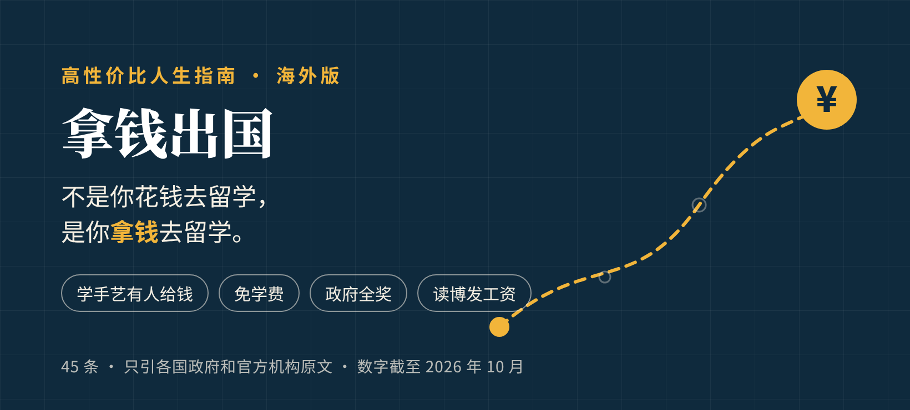

<div align="center">



# 高性价比人生指南 · 海外版：拿钱出国

讲怎么不花钱、甚至拿着钱出国学东西。学手艺、学护理，读本科、硕士、博士，蓝领白领都有路。<br>
45 条建议，每条写明你要付出什么、能换回什么、证据有多硬，来源只引各国政府、政府机构、法律原文和公立大学官网。

不用全做：这是一份备选单，不是任务清单。挑一两条够得着的，就算数。

奖学金和签证政策每年都改，书里的数字可能过时，也可能有错。真去申请时，以各国政府、使领馆和学校的最新官方说法为准。发现写错了，欢迎[提 issue](https://github.com/BeckyGlobal/PaidToStudyAbroad/issues)。

[](https://beckyglobal.github.io/PaidToStudyAbroad/)
[](#目录)
[](#证据分级)
[](docs/核实记录/)
[](#许可)

### [打开在线检索页](https://beckyglobal.github.io/PaidToStudyAbroad/)

<table>
<tr><td align="right"><b>查阅</b></td><td align="left">

[目录](#目录) · [证据分级](#证据分级) · [核实记录](docs/核实记录/) · [拿钱之前先看绳子](#拿了钱要付出什么几根常见的绳子)

</td></tr>
<tr><td align="right"><b>检索</b></td><td align="left">

[在线检索页](https://beckyglobal.github.io/PaidToStudyAbroad/)：按国家、按节、按证据等级、按花不花钱筛选全部 45 条

</td></tr>
<tr><td align="right"><b>灵感来源</b></td><td align="left">

[《高性价比人生指南》](https://github.com/eternity4719/HowToLiveBetter)（eternity4719，CC BY 4.0）。本仓库是读者做的非官方衍生作品，和原作者没有关系

</td></tr>
</table>

</div>

## 这份指南想回答的问题

| 问题 | 去哪看 |
| --- | --- |
| 没学历、没钱，能不能出去学门手艺，学的时候还有人发钱？ | [1. 学手艺，有人给钱：职业培训和护理](book/01-学手艺有人给钱.md) |
| 想出去读本科、硕士，哪些国家不要学费或者学费很低，签证要存多少钱，能不能打工？ | [2. 本科和硕士：不要学费，或者学费很低的地方](book/02-学费低或不要学费.md) |
| 哪些政府奖学金收中国人，每月给多少，拿了钱要不要回国服务？ | [3. 政府给全奖：本科、硕士、博士](book/03-政府全奖.md) |
| 读博能不能当成一份工作，每月拿工资、交社保，毕业还能留下来？ | [4. 读博就是上班：有的国家博士生是员工，按月发工资](book/04-读博就是上班.md) |
| 哪些名气很大的奖学金不收中国人，哪些国家以前免学费、现在不免了？ | [别白费劲](#别白费劲) |

## 怎么读

- **不用全做**：挑一两条你够得着的就行。语言、学历、年龄，每条的「成本」栏都写了门槛。
- **想按条件挑**：打开[在线检索页](https://beckyglobal.github.io/PaidToStudyAbroad/)，可以按国家、按节、按证据等级筛，也可以按「花不花钱、花多少时间、要不要毅力」筛，几个条件能叠着用。
- **只看结论**：每条都有一行「说人话」，把官方文件里的规定翻成大白话。它只用「收益」栏里写到的数字，不另加。
- **想核对**：每条的「来源」栏都是官方原文链接。每节的[核实记录](docs/核实记录/)列出了支撑每个数字的原文短句和核实日期。
- **拿钱之前先看「备注」**：要不要回国服务、要不要在当地干满几年、违约要不要还钱，都写在备注里。
- **钱的换算**：欧元、日元、加元、美元按 2026 年 10 月 12 日人民币中间价折算，其他币种保留原币。

每条建议长这样：

```markdown
### 8. 申请 DAAD 赫尔穆特·施密特硕士奖学金：读政法经管类硕士，每月 992 欧元
<!-- 成本标签: 钱=0 时间=多 毅力=是 收益=中 口径=金钱 -->
- 成本：本科要读政治、法律、经济或公共管理，成绩优秀。拿到最高学历不超过 6 年。读硕士前要先在德国上 6 个月德语课。
- 说人话：学政法经管的本科生，可以拿德国的钱读硕士。每月 992 欧元，读 2 到 4 个学期。每年 6 月到 7 月申请。
- 收益：DAAD 中国办公室页面写明：992 欧元/月（约 7,466 元人民币）。资助 2 到 4 个学期，看课程长短。另管一次性国际交通补助，以及医疗、意外和责任保险。申请时间一般是每年 6 月 1 日到 7 月 31 日。申请截止时在德国住了 15 个月以上的人不行。
- 证据等级：A
- 来源：德意志学术交流中心北京代表处. Helmut-Schmidt硕士奖学金（PPGG）（2026）. <https://www.daad.org.cn/zh/find-funding/funding-programmes-in-germany/helmut-schmidt-ppgg/>
- 备注：页面没写学费资不资助，待核实。页面没有正式的回国条款，只写项目目的是培养将来服务原籍国的人。语言可以用德语或英语，具体分数页面没写。
```

## 拿了钱要付出什么：几根常见的绳子

| 绳子 | 例子 |
|---|---|
| 学成后必须回国服务 | 国家公派留学，要按期回国服务，CSC 另一项目的问答写明服务期两年（第 3 节第 1 条）；英国志奋领，读完回国至少两年（第 3 节第 6 条） |
| 必须在当地工作满几年，否则要还钱 | 大阪介护福祉士修学资金，在府内干满 5 年免还（第 1 节第 5 条）；冈山县养老院奖学金，没干满 5 年县里要收回补贴（第 1 节第 6 条） |
| 毕业后在当地工作几年 | 新加坡教育部学费补贴，要在新加坡工作 3 年（第 2 节第 11 条） |
| 没有服务期 | 魁北克职业培训奖学金（第 1 节第 1 条）；韩国 GKS、Erasmus Mundus 等（见第 3 节各条备注） |

## 证据分级

每条建议都标注证据等级：

| 等级 | 含义 |
| --- | --- |
| A | 官方原文直接写明了数字或规定，打开来源链接就能找到 |
| B | 官方有依据，但金额因地区、学校、合同而不同，或者要按官方数字推算 |
| C | 经验或共识，没有官方原文 |

全书 45 条中 A 级 29 条、B 级 16 条、C 级 0 条。来源只引各国政府、政府机构和使领馆、法律原文、公立大学官网，以及政府委托或出资运营的项目官网（比如 DAAD、魁北克的 boursesqma.com），不引中介、媒体和自媒体。全书共 150 条来源链接。

## 目录

1. [学手艺，有人给钱：职业培训和护理](book/01-学手艺有人给钱.md)：加拿大魁北克的职业培训奖学金、德国护理培训和法定最低培训工资、奥地利上奥地利州护理补助，以及日本大阪的介护福祉士修学资金和冈山、宫崎、三重三县的养老院奖学金补贴。写清每笔钱怎么发、要不要还、语言门槛和签证要求。共 8 条。

   <details><summary>展开本节 8 条</summary>

   1.1 申请魁北克职业培训奖学金，学电工、焊工等手艺，最多拿 26,600 加元  
   1.2 去德国读护理培训，不交学费，公立单位（TVAöD 标准）第一年每月 1,490.69 欧元工资  
   1.3 在德国读职业培训，法律规定 2026 年入学的第一年每月至少 724 欧元  
   1.4 去奥地利上奥地利州读护理，每月领 658.40 欧元补助  
   1.5 在大阪读介护学校，每月借 5 万日元，毕业后在大阪干满 5 年全免  
   1.6 到冈山读介护，养老院可以给你学费每年最多 60 万日元（2024 年度标准）  
   1.7 到宫崎读介护，养老院出学费每年最多 60 万日元，县政府补三分之一  
   1.8 到三重读介护，养老院出学费每年最多 60 万日元，县里补三分之一  

   </details>

2. [本科和硕士：不要学费，或者学费很低的地方](book/02-学费低或不要学费.md)：德国公立大学免学费和学期杂费、留学签证资金证明、学生打工上限；奥地利、捷克、波兰、法国、意大利的低学费或免学费路线；日本国立大学学费减免和 JASSO 学习奖励费；新加坡教育部学费补贴和 3 年服务期。节末两条讲芬兰、瑞典、丹麦、荷兰、挪威已经不免学费。共 13 条。

   <details><summary>展开本节 13 条</summary>

   2.1 申请德国公立大学，多数专业不收学费，每学期只交 100 到 350 欧杂费  
   2.2 准备德国学生签证，要证明一年有 11,904 欧，自保账户、奖学金、担保书都行  
   2.3 在德国边读书边打工，每年最多 140 个全天或 280 个半天  
   2.4 申请奥地利公立大学，非欧盟学生每学期交 726.72 欧  
   2.5 学会捷克语，在捷克公立大学读本科、硕士全免学费  
   2.6 考到波兰语 C1 证书，在波兰公立大学读全日制项目和波兰人一样免学费  
   2.7 申请法国公立大学，非欧盟学生学费一年 2,902 欧起，学校还能免掉一部分人  
   2.8 申请意大利大区奖学金（DSU），学费全免、管饭，还可能补每年 3,150 欧房租  
   2.9 读日本国立大学，标准学费一年 535,800 日元，经济困难还能申请全免或半免  
   2.10 考好日本留学考试（EJU），申请 JASSO 学习奖励费，每月 48,000 日元  
   2.11 申请新加坡教育部学费补贴，NUS 工科学费从每年 39,700 新元降到 21,400 新元，毕业要在新加坡工作 3 年  
   2.12 别指望芬兰、瑞典、丹麦、荷兰免学费，芬兰、丹麦一年就要 6,000 到 20,000 欧  
   2.13 别再信“挪威公立大学免学费”，2023 年秋季起收费，挪威科技大学 2026/27 学年人文社科类一年 176,300 挪威克朗  

   </details>

3. [政府给全奖：本科、硕士、博士](book/03-政府全奖.md)：国家公派留学、日本文部科学省、韩国 GKS、匈牙利、土耳其、英国志奋领、DAAD、瑞士政府卓越奖学金、欧盟伊拉斯谟世界联合硕士、法国埃菲尔、爱尔兰政府、香港博士研究生奖学金、澳大利亚研究训练奖学金。节末一条列出不收中国大陆申请人的项目。共 15 条。

   <details><summary>展开本节 15 条</summary>

   3.1 申请国家公派读博：国家出往返机票，奖学金最长发 48 个月  
   3.2 申请日本文部科学省奖学金读研：每月 143,000 到 145,000 日元，学费全免  
   3.3 申请韩国政府奖学金 GKS 读研：学位阶段每年 16,560,000 韩元，先免费学 1 年韩语  
   3.4 申请匈牙利政府奖学金：免学费、给宿舍，博士后期每月 180,000 福林  
   3.5 申请土耳其政府奖学金：本科生也能拿，每月 6,500 里拉，管学费住宿和 1 年土耳其语  
   3.6 申请英国志奋领：1 年硕士学费、机票、生活费全包，读完回国至少 2 年  
   3.7 申请 DAAD 博士科研奖学金去德国读博：每月 1,400 欧元，最长 4 年  
   3.8 申请 DAAD 赫尔穆特·施密特硕士奖学金：读政法经管类硕士，每月 992 欧元  
   3.9 申请瑞士政府卓越奖学金去瑞士做博士研究：每月 2,450 瑞士法郎  
   3.10 申请欧盟伊拉斯谟世界联合硕士：每月 1,400 欧元，不收学费  
   3.11 让法国大学推荐你拿埃菲尔奖学金：博士每月 2,000 欧元，硕士每月 1,200 欧元  
   3.12 申请爱尔兰政府国际教育奖学金：学费全免，再给 10,000 欧元  
   3.13 申请香港博士研究生奖学金：2026/27 学年标准每年 344,400 港元，2027/28 学年发 400 个  
   3.14 申请澳大利亚研究训练奖学金读博：可免学费，2027 年生活费基础额 35,550 澳元  
   3.15 别白费劲：这些不收中国大陆申请人  

   </details>

4. [读博就是上班：有的国家博士生是员工，按月发工资](book/04-读博就是上班.md)：荷兰、德国、瑞典、丹麦、挪威、芬兰、瑞士、奥地利的带薪博士岗位，以及欧盟玛丽居里博士网络。写清月薪、是不是劳动合同、有没有社保养老金、能不能带家属、毕业后有多久找工作。共 9 条。

   <details><summary>展开本节 9 条</summary>

   4.1 去荷兰读博当大学员工：第一年月薪 3,204 欧元，第四年涨到 4,051 欧元  
   4.2 去德国当大学科研员工读博：E13 全职月薪 4,759.37 欧元起，签多少比例拿多少  
   4.3 去瑞典读博签“博士生雇佣”：乌普萨拉大学起薪每月 34,000 瑞典克朗，博士阶段不收学费  
   4.4 去丹麦当带薪 PhD：奥胡斯大学起薪每月 31,845 丹麦克朗，毕业后给 3 年找工作居留  
   4.5 去挪威当 stipendiat（博士研究员）：NTNU 最低年薪 550,800 挪威克朗，加入国家养老金  
   4.6 去芬兰当 doctoral researcher：图尔库大学月薪约 2,400–3,300 欧元，毕业后 2 年找工作  
   4.7 去瑞士读博：国家科学基金会把博士生年薪下限提到 50,000 瑞郎，EPFL 统一发 55,000 瑞郎  
   4.8 去奥地利做 FWF 项目博士生：2026 年标准每周 30 小时，每月 2,832.10 欧元  
   4.9 申请欧盟玛丽居里博士网络岗位：任何国籍都能报，欧盟按每人每月 4,250 欧元给单位拨生活津贴，要乘国家系数  

   </details>

## 别白费劲

有些很有名的奖学金不收中国大陆申请人，比如 Australia Awards、新西兰 Manaaki、美国富布赖特外国学生项目。有些国家以前免学费，现在不免了，比如挪威（2023 年秋季起收费）。详见第 2 节第 12、13 条和第 3 节第 15 条。

## 免责声明

本指南不是法律、移民或财务意见。作者不是持牌移民顾问，也不推荐任何学校、机构或中介。真去申请时，以各国政府、使领馆和学校的最新官方说法为准。

## 许可

正文按 [CC BY 4.0](LICENSE) 发布，可以转载、改编、商用，只要注明出处并附上本仓库链接。
